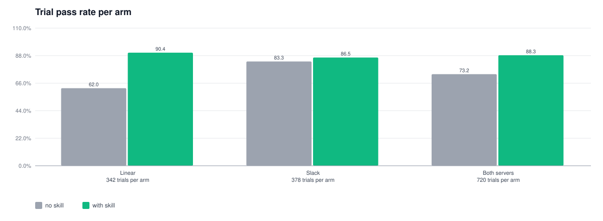
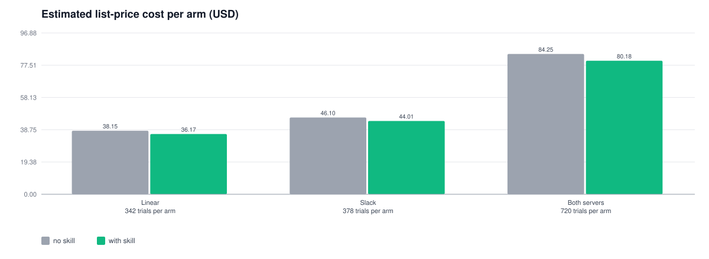
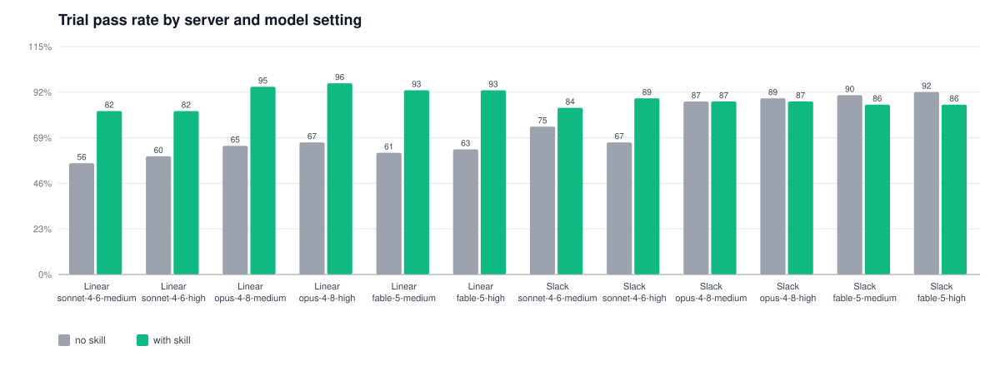
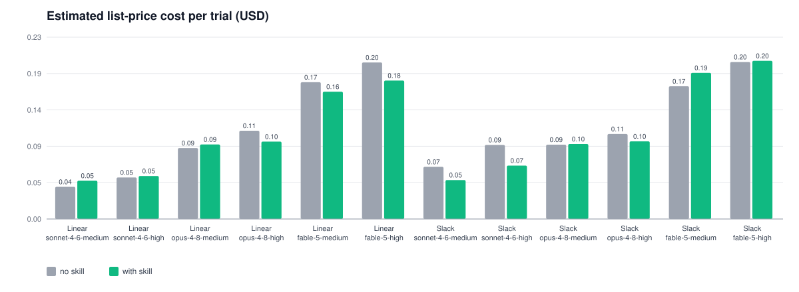
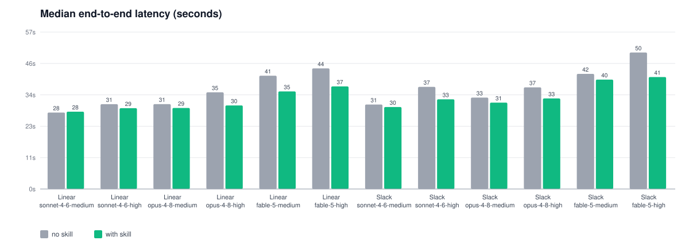
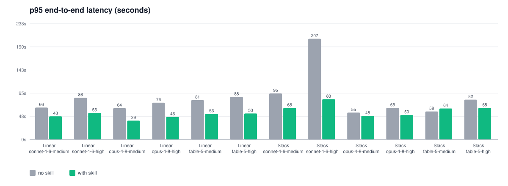
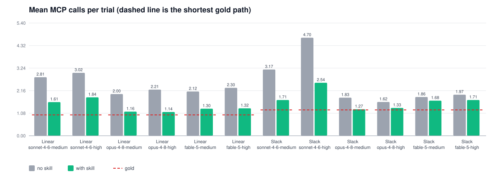
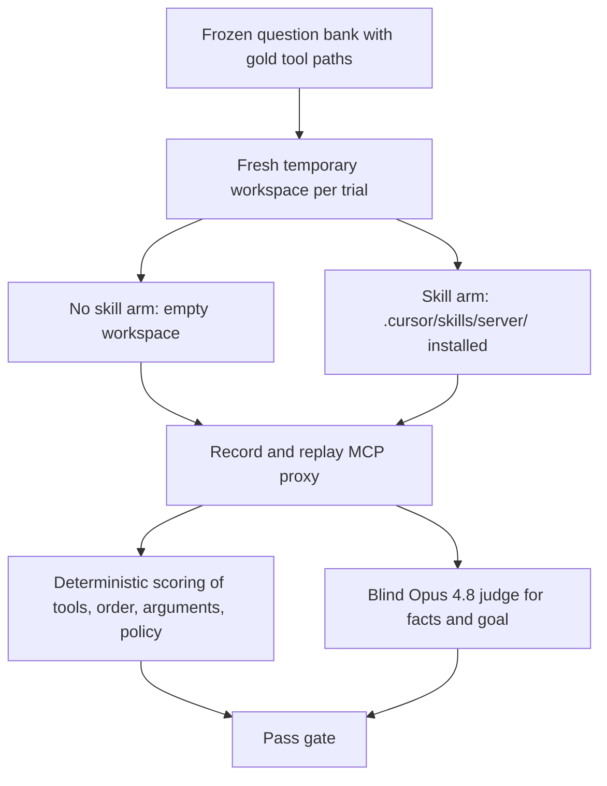

# Final results: MCP skills for Linear and Slack

This document is the single entry point for the benchmark's conclusions. It
covers two arms over the same 40 questions, six Claude settings, and three
attempts each:

- **No skill.** The agent sees only the MCP tool roster.
- **With skill.** A short `SKILL.md` index plus `references/` files that the
  agent reads only for the object it has already chosen.

Everything below is generated from the saved trajectories by
`eval/scripts/final_results.py`. Detailed reports and figures are linked
at the end.

## Summary

| Metric (all 720 trials per arm) | No skill | With skill |
| --- | --- | --- |
| Trial pass rate | 527/720 (73.2%) | **636/720 (88.3%)** |
| Pass@3 (questions with at least one pass, of 240) | 198/240 | **230/240** |
| Strict reliability (all three attempts pass, of 240) | 150/240 | **190/240** |
| Estimated list-price cost, whole arm | $84.25 | **$80.18** |
| Mean input tokens per trial | 45.1k | **42.7k** |
| Mean output tokens per trial | 1.51k | 1.15k |
| Median latency | 36.3s | 33.1s |
| p95 latency | 78.7s | **57.6s** |
| Mean MCP calls per trial (gold 1.12) | 2.47 | **1.56** |

Per server:

| Server | No skill | With skill | Change |
| --- | --- | --- | --- |
| Linear | 212/342 (62.0%) | 309/342 (90.4%) | +28.4 pp |
| Slack | 315/378 (83.3%) | 327/378 (86.5%) | +3.2 pp |

## The skill

Each skill is a short index the agent can keep in view, plus reference
files it opens only after the index has chosen an object.

| Server | Index (`SKILL.md`) | References (read on demand) |
| --- | --- | --- |
| Linear | 56 lines, 3.4 KB | 4 files, 76 lines, 4.3 KB |
| Slack | 55 lines, 3.2 KB | 3 files, 61 lines, 4.2 KB |

The agent opened at least one `references/` file in 83% of Linear trials and 76% of Slack trials. The rest answered from the index alone.

## Accuracy

- On Linear, the skill improves 6 of 6 settings (sonnet-4-6-medium, sonnet-4-6-high, opus-4-8-medium, opus-4-8-high, fable-5-medium, fable-5-high).
- On Slack, the skill improves sonnet-4-6-medium, sonnet-4-6-high and falls for opus-4-8-high, fable-5-medium, fable-5-high.
- The Slack no-skill baseline is already near ceiling for Opus and Fable, so
  the index has less to add there. The per-question table below shows
  which Slack questions account for the losses.
- Opus 4.8 with the Linear skill reaches 55/57 (96.5%) at high effort and 54/57 (94.7%) at medium.

## Cost

- The skill is cheaper than no skill in 6 of 12 server and model settings.
- Whole-benchmark cost is $80.18 with the skill and $84.25 without it.
- The index stays small. A reference file is loaded only for the object
  the index has already chosen.

## Latency

- p95 latency is lower with the skill in 11 of 12 settings. The long
  tail shortens because there are fewer wrong-tool detours.
- Median latency is lower with the skill in 11 of 12 settings.
- The replay proxy is local, so these are harness timings, not live API
  latencies.

## MCP calls

- The skill makes fewer MCP calls than no skill in 12 of 12 settings
  and moves closer to the shortest gold path. Skill-file reads are not MCP
  calls and are excluded.

## Headline table

Each cell reads no skill, then with skill.

| Server | Model / effort | Trial pass | Pass@3 | Strict reliability | Mean input tokens | Mean output tokens | Estimated cost/trial | Median latency | p95 latency | MCP calls (gold; arms) |
| --- | --- | --- | --- | --- | --- | --- | --- | --- | --- | --- |
| Linear | sonnet-4-6-medium | 32/57 (56.1%) → 47/57 (82.5%) | 11/19 → 17/19 | 10/19 → 14/19 | 31.2k → 32.7k | 0.99k → 0.90k | $0.041 → $0.049 | 27.8s → 28.1s | 65.7s → 47.6s | 1.00; 2.81 → 1.61 |
| Slack | sonnet-4-6-medium | 47/63 (74.6%) → 53/63 (84.1%) | 18/21 → 19/21 | 12/21 → 16/21 | 45.1k → 33.9k | 1.50k → 1.21k | $0.066 → $0.050 | 30.7s → 29.8s | 94.6s → 64.8s | 1.24; 3.17 → 1.71 |
| Linear | sonnet-4-6-high | 34/57 (59.6%) → 47/57 (82.5%) | 14/19 → 18/19 | 8/19 → 13/19 | 37.0k → 37.0k | 1.36k → 1.08k | $0.053 → $0.055 | 30.8s → 29.4s | 85.8s → 54.6s | 1.00; 3.02 → 1.84 |
| Slack | sonnet-4-6-high | 42/63 (66.7%) → 56/63 (88.9%) | 17/21 → 21/21 | 12/21 → 17/21 | 66.9k → 51.9k | 2.63k → 1.83k | $0.094 → $0.068 | 37.1s → 32.6s | 207.0s → 82.7s | 1.24; 4.70 → 2.54 |
| Linear | opus-4-8-medium | 37/57 (64.9%) → 54/57 (94.7%) | 15/19 → 19/19 | 10/19 → 16/19 | 38.6k → 36.7k | 1.22k → 0.88k | $0.090 → $0.095 | 30.8s → 29.5s | 64.3s → 38.7s | 1.00; 2.00 → 1.16 |
| Slack | opus-4-8-medium | 55/63 (87.3%) → 55/63 (87.3%) | 20/21 → 19/21 | 16/21 → 17/21 | 37.2k → 40.4k | 1.41k → 1.06k | $0.095 → $0.095 | 33.2s → 31.4s | 55.4s → 48.5s | 1.24; 1.83 → 1.27 |
| Linear | opus-4-8-high | 38/57 (66.7%) → 55/57 (96.5%) | 16/19 → 19/19 | 10/19 → 18/19 | 45.2k → 40.2k | 1.56k → 0.97k | $0.112 → $0.098 | 35.1s → 30.4s | 75.6s → 46.4s | 1.00; 2.21 → 1.14 |
| Slack | opus-4-8-high | 56/63 (88.9%) → 55/63 (87.3%) | 19/21 → 19/21 | 18/21 → 18/21 | 41.1k → 40.8k | 1.57k → 1.15k | $0.108 → $0.099 | 36.9s → 32.9s | 65.0s → 50.3s | 1.24; 1.62 → 1.33 |
| Linear | fable-5-medium | 35/57 (61.4%) → 53/57 (93.0%) | 14/19 → 19/19 | 9/19 → 15/19 | 47.9k → 43.6k | 1.31k → 0.91k | $0.174 → $0.162 | 41.2s → 35.5s | 80.8s → 52.8s | 1.00; 2.12 → 1.30 |
| Slack | fable-5-medium | 57/63 (90.5%) → 54/63 (85.7%) | 20/21 → 20/21 | 18/21 → 15/21 | 45.5k → 51.6k | 1.24k → 1.24k | $0.169 → $0.186 | 41.8s → 39.8s | 57.6s → 63.7s | 1.24; 1.86 → 1.68 |
| Linear | fable-5-high | 36/57 (63.2%) → 53/57 (93.0%) | 14/19 → 19/19 | 9/19 → 16/19 | 52.2k → 47.8k | 1.59k → 1.05k | $0.199 → $0.176 | 43.8s → 37.3s | 87.5s → 53.5s | 1.00; 2.30 → 1.32 |
| Slack | fable-5-high | 58/63 (92.1%) → 54/63 (85.7%) | 20/21 → 21/21 | 18/21 → 15/21 | 51.3k → 53.8k | 1.63k → 1.45k | $0.200 → $0.201 | 49.6s → 40.7s | 82.0s → 64.8s | 1.24; 1.97 → 1.71 |

## Questions that moved

Passing attempts summed over all six settings (18 attempts per question per
arm). Positive change means the skill passed more often than no skill.

### Linear

| Question | Class | No skill | With skill | Change |
| --- | --- | --- | --- | --- |
| lin-milestone-vs-cycle-06 | overlap_linear | 0/18 | 16/18 | +16 |
| cx-issue-to-cycle-01 | multi_hop | 3/18 | 18/18 | +15 |
| lin-cycle-vs-issues-01 | overlap_linear | 0/18 | 15/18 | +15 |
| gap-delete-linear-issue-10 | capability_gap | 6/18 | 18/18 | +12 |
| lin-initiative-vs-project-05 | overlap_linear | 0/18 | 9/18 | +9 |
| lin-project-vs-issues-04 | overlap_linear | 10/18 | 18/18 | +8 |
| cx-review-and-ticket-discussion-02 | multi_hop | 12/18 | 18/18 | +6 |
| lin-status-vs-comments-10 | overlap_linear | 8/18 | 14/18 | +6 |
| lin-link-vs-file-attachment-12 | overlap_linear | 13/18 | 17/18 | +4 |
| lin-diff-threads-vs-comments-11 | overlap_linear | 15/18 | 18/18 | +3 |
| policy-linear-merge-02 | destructive | 12/18 | 15/18 | +3 |
| lin-comment-vs-description-09 | overlap_linear | 17/18 | 16/18 | -1 |
| lin-help-vs-document-08 | overlap_linear | 17/18 | 18/18 | +1 |

### Slack

| Question | Class | No skill | With skill | Change |
| --- | --- | --- | --- | --- |
| gap-edit-sent-message-07 | capability_gap | 12/18 | 18/18 | +6 |
| slack-members-vs-users-07 | overlap_slack | 18/18 | 12/18 | -6 |
| slack-private-search-03 | overlap_slack | 18/18 | 12/18 | -6 |
| cx-reply-to-parent-thread-06 | multi_hop | 13/18 | 17/18 | +4 |
| slack-list-vs-canvas-10 | overlap_slack | 9/18 | 13/18 | +4 |
| amb-shared-doc-object-11 | underspecified | 13/18 | 16/18 | +3 |
| slack-history-vs-search-01 | overlap_slack | 15/18 | 18/18 | +3 |
| slack-topic-vs-history-02 | overlap_slack | 12/18 | 15/18 | +3 |
| eff-projection-channels-13 | efficiency | 17/18 | 15/18 | -2 |
| sec-private-then-draft-15 | security | 16/18 | 18/18 | +2 |
| slack-thread-vs-channel-04 | overlap_slack | 9/18 | 7/18 | -2 |
| cx-canvas-read-before-update-04 | multi_hop | 5/18 | 6/18 | +1 |
| gap-cancel-scheduled-08 | capability_gap | 17/18 | 18/18 | +1 |
| slack-upload-vs-message-12 | overlap_slack | 15/18 | 16/18 | +1 |

## Method in brief

- Six pinned settings: Sonnet 4.6, Opus 4.8, and Fable 5, each at medium and
  high effort, three attempts per question and arm.
- 19 Linear and 21 Slack questions built around confusable tools: planning
  levels, document versus documentation, comments versus review threads,
  search versus history versus thread, send versus draft versus schedule,
  missing capabilities, and destructive confirmations.
- A trial passes only when tool discoverability, sequence, security policy,
  and goal effectiveness are all 1, factual correctness is at least 0.5, and
  execution efficiency is at least 0.7. See `eval/RUBRIC.md`.
- Cost uses Cursor list prices checked on 17 September 2026 and excludes the
  judge. Latency is adapter wall-clock time.
- The with-skill arm was measured on 29 September 2026. The no-skill arm
  does not load a skill, so the 17 September no-skill runs are reused.

## Limitations

- Three attempts per cell. Single-question movements of one attempt are
  within noise; read the pooled rows first.
- The with-skill runs and the no-skill runs are 12 days apart. Model
  behavior behind a pinned id can drift; the no-skill arm was not rerun.
- Two pass dimensions are model-judged.
- The bank concentrates on confusable tools and is not a sample of everyday
  MCP traffic.
- Replay removes live service latency and data drift.

## Artifacts

| Artifact | Path |
| --- | --- |
| Comparison | [eval/results/comparison/SKILL_COMPARISON.md](eval/results/comparison/SKILL_COMPARISON.md) |
| Comparison workbook | [eval/results/comparison/SKILL_COMPARISON.xlsx](eval/results/comparison/SKILL_COMPARISON.xlsx) |
| Figures | [eval/results/figures/](eval/results/figures/) |
| Historical unpinned run | [eval/results/historical/RESULTS.md](eval/results/historical/RESULTS.md) |
| Skills | [skills/linear/](skills/linear/), [skills/slack/](skills/slack/) |
| No-skill trajectories | `eval/experiments/<server>/model-runs/<setting>/baseline/` |
| With-skill trajectories | `eval/experiments/<server>/model-runs/<setting>-v2/treatment/` |
| Gold questions | [eval/experiments/linear/questions.jsonl](eval/experiments/linear/questions.jsonl), [eval/experiments/slack/questions.jsonl](eval/experiments/slack/questions.jsonl) |
| Rubric | [eval/RUBRIC.md](eval/RUBRIC.md) |
