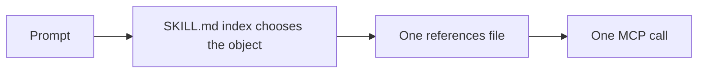

# mcp-skillbench

Reproducible Linear and Slack MCP skill benchmark.

The same tasks, models, tool schemas, and replayed tool data run twice. **No skill** sees the MCP tool roster only. **With skill** also sees one progressive skill: a short `SKILL.md` index and on-demand files under `references/`.



## Use the skills

The Linear and Slack bundles are in [`skills/`](skills/). [`skills/README.md`](skills/README.md) covers directory names, frontmatter, and local Cursor installation. Publishing a shared copy is covered in [`docs/truefoundry-skills-registry.md`](docs/truefoundry-skills-registry.md).

## Results

Read [`FINAL_RESULTS.md`](FINAL_RESULTS.md) for the per-configuration table and the questions that moved. Scoring rules are in [`eval/RUBRIC.md`](eval/RUBRIC.md). Question banks are [`eval/experiments/linear/questions.jsonl`](eval/experiments/linear/questions.jsonl) and [`eval/experiments/slack/questions.jsonl`](eval/experiments/slack/questions.jsonl).

| Metric (720 trials per arm) | No skill | With skill |
| --- | ---: | ---: |
| Trial accuracy | 527/720 (73.2%) | **636/720 (88.3%)** |
| Estimated list-price cost | $84.25 | **$80.18** |
| Median end-to-end latency | 36.3s | **33.1s** |
| p95 end-to-end latency | 78.7s | **57.6s** |
| Mean MCP calls per trial | 2.47 | **1.56** |

| Server | No skill | With skill |
| --- | ---: | ---: |
| Linear (342 trials) | 212/342 (62.0%) | **309/342 (90.4%)** |
| Slack (378 trials) | 315/378 (83.3%) | **327/378 (86.5%)** |


The with-skill arm was measured on 29 September 2026. The no-skill arm does not load a skill, so the 17 September no-skill runs are reused. `integration-cross` and `eval/results/historical/` are outside these numbers.

## Reproduce the experiment

Python 3.11 or newer. [`REPRODUCING.md`](REPRODUCING.md) is the full guide.

```bash
make setup
make check
make reproduce-reports
```

`make check` is free. `make reproduce-reports` unpacks the trajectory archive in this repository and rebuilds the reports and figures above. A paid pilot or full sweep needs `CURSOR_API_KEY` and is described in the reproduction guide. Data layout and redaction are in [`DATA.md`](DATA.md).
